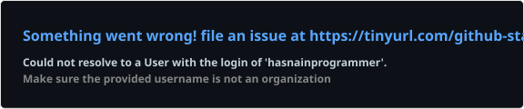

 

## About Me:
I help teams build, scale, and maintain reliable web applications that users actually enjoy using. As a Full-Stack Developer with hands-on industry experience, I contribute across the entire product lifecycle—from clean, responsive UIs to robust backend systems.  You’ll benefit from my experience working with JavaScript, React, Python, Django, and the MERN stack, where I’ve delivered production features, fixed critical bugs, optimized performance, and collaborated in Agile, Git-driven environments. I focus on building solutions that are easy to scale, simple to maintain, and safe to use, so teams can move fast without accumulating technical debt.  If you need someone who can quickly understand your codebase, improve user experience, and ship features without constant supervision, I bring that reliability—along with strong problem-solving skills and a mindset focused on real business impact, not just code.

## Tech Stack

### Languages

### Frontend

### Backend

### Databases, DevOps & Tools

## Socials
  

## GitHub Activity

